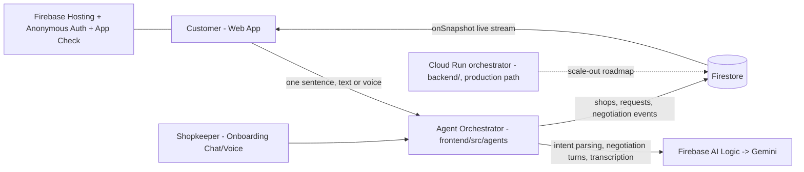

# BAZAAR — Master Plan
### AI Builder Cup 2026 · Theme: Retail & Commerce — Intelligent Customer and Business Experiences

> **One-liner:** Bazaar is an agent-to-agent commerce network that gives every offline shop an AI agent — so a customer's AI can discover, query, and *negotiate* with dozens of local shops in parallel, in seconds.

---

## 1. The Problem

- India has **~13 million+ offline retail shops** (kiranas, pharmacies, bakeries, hardware stores, boutiques). They are ~90% of Indian retail.
- E-commerce and quick-commerce digitized only a thin slice of retail. The rest stayed offline — **not because shops are worse, but because onboarding them is impossible**: they have no digital catalogs, no inventory systems, no staff to manage apps, and often limited English/typing comfort.
- Result: a customer who needs *"a 1kg eggless chocolate cake under ₹500 by 6pm"* has two options — physically call/visit shops one by one, or give up and order from a big platform. **Local shops lose the sale every single day simply because they can't answer.**
- Meanwhile shopkeepers already have the only two tools they need: **a phone and WhatsApp.**

### The insight that makes this possible *now*
Gen AI deleted the onboarding friction. A shop no longer needs a catalog, an app, or training — it needs **an AI agent that learns the shop by chatting with the owner** and then represents the shop to the world 24/7, in any language.

---

## 2. The Solution

Bazaar is a **two-sided agentic network**:

### Supply side — every shop gets an agent (5-minute onboarding)
- The shopkeeper chats with their agent in their own language (a WhatsApp-style chat in the prototype): *"Bhaiya, hum eggless cake banate hain, 1kg ₹450–550, 4 ghante ka notice chahiye."*
- Gemini converts this conversational knowledge into a **structured, queryable shop profile** in Firestore: products, price ranges, constraints, delivery radius, timings, negotiation flexibility.
- From that moment, the shop's agent can answer customers, quote prices, check feasibility, and **negotiate within the owner's price floors** — around the clock.

### Demand side — every customer gets a buyer agent
- The customer states a need in one sentence (text or voice): *"I need a 1kg eggless chocolate cake under ₹500, delivered to Andheri by 6pm."*
- The buyer agent parses intent → fans out to **all matching shop agents in parallel** → each shop agent checks its own inventory/constraints and responds with offers → the buyer agent **negotiates** (counter-offers, bundling delivery, trading price vs. time) → returns the best deal in ~60–90 seconds with a full negotiation transcript.

### The signature experience (what judges see)
A **split-screen "negotiation theatre"**: left side, the customer's single sentence; right side, a live stream of 5–8 simultaneous agent-vs-agent negotiations — bids, counters, rejections, and a deal closing in real time. This is the demo moment the whole build is designed around.

---

## 2.5 Sample Scenario — the full flow, both sides

### 🏪 Seller side: Ramesh, hardware store, Andheri East

Ramesh runs a small hardware shop. He's good at his trade, bad at phones — he misses calls while cutting pipe, and he's not on any app ("too much hassle — photos, prices, commission").

**Monday, 10 AM — onboarding (one-time, ~5 minutes):**
A Bazaar field rep (or his nephew) opens the chat, and Ramesh just talks:

> *"My shop is called Sharma Hardware. I sell paint, plumbing supplies, electrical fittings — everything. Asian Paints 1-litre starts at ₹380, pipe fittings ₹40–200, Anchor switchboards ₹150..."*

No forms, no photos, no catalog. Gemini turns this rambling into a structured shop profile (products, price ranges, price floors, lead times, negotiation style). **Ramesh's agent is now live 24/7**, and Ramesh goes back to cutting pipe. When prices change, he just tells it: *"Paint price went up — it's 400 now."*

**That same night, 11:30 PM:**
A customer's agent contacts Ramesh's agent: "Need 2 litres of white emulsion plus a roller, pickup tomorrow 8 AM, budget ₹900." Ramesh is asleep. His agent checks his stock knowledge, quotes ₹870, haggles briefly, closes the order. Ramesh wakes up to: *"1 order confirmed — ₹870. Customer coming at 8 AM for paint + roller. Keep it ready."*

**He made a sale while sleeping.** Before Bazaar, that inquiry would have gone unanswered and the customer would have ordered from a quick-commerce dark store instead.

### 🛍️ Buyer side: Priya, Friday 4 PM, mild panic

Priya's daughter's birthday is tomorrow and she just remembered the cake. Her usual options: call 5 bakeries one by one (half don't answer), scroll delivery apps (same 3 chain bakeries, nothing matching), or walk shop to shop after work. 

**With Bazaar, she types one sentence:**

> *"1kg eggless photo cake with my daughter's picture, under ₹700, ready by 4 PM tomorrow near Andheri West"*

Then she watches the live negotiation theatre for ~90 seconds:

| Shop agent | How it plays out |
|---|---|
| **Monginis** | "Photo cake ₹750, ready by 2 PM" → buyer agent: "Budget is ₹700 — can you match it?" → "₹720 final, free candles included" |
| **Dawat Home Bakers** | "We'll do it for ₹650, but pickup only" → buyer agent: "Deal, if it's ready by 3 PM" → **"Done ✅"** |
| **Theobroma** | "We don't make photo cakes" → *dropped out* |
| **Sharma Sweets** | "₹680 with delivery!" → came second |

**She gets an Order Ticket:** order ID, final price ₹650, pickup at the shop's address with a Maps link, ready-by time, payment at handover (cash/UPI). For delivery deals, her exact address is shared **only with the winning shop** — the losing bidders never see it.

**Result: ₹650, from a home baker she would never have found, ₹50 under budget, zero phone calls** — and the order went to a woman running a home bakery with no app presence, who beat three bigger shops because her agent could answer and negotiate for her.

### The point hiding in the story
- Priya didn't "compare prices on apps" — **none of these prices existed anywhere online** until the agents asked for them in real time.
- Ramesh and the home baker got what delivery apps never gave them: digital customers, **without changing anything about how they work**.
- Post-deal flow: fulfillment (pickup / shop delivers / courier API in roadmap) and payment (pay-at-handover now; UPI deep links, then escrow, in roadmap) attach to the deal — Bazaar stays asset-light, no fleets, no warehouses.
- Multiply by 13 million shops and a billion "I need something by tomorrow" moments — small task × massive frequency = infrastructure.

### The onboarding ladder (effort → zero over time)
| Stage | How a shop joins | Owner effort |
|---|---|---|
| 1. Chat/voice (prototype ✅) | Owner describes the shop in their language — text or voice note | ~5 minutes |
| 2. 📸 Photo onboarding (prototype stretch goal) | Photograph the price board / shelves / supplier bills — Gemini vision builds the catalog | 3 photos |
| 3. Claim-your-shop (roadmap) | Bazaar pre-builds a draft agent from the shop's public Google Maps listing; owner confirms with one tap | 1 tap |
| 4. Lazy onboarding (roadmap) | Agent starts with just name + category and **learns the catalog from real customer queries** — when it can't answer, it asks the owner once ("Someone wants a photo cake — do you make those? Price?") and remembers forever | Zero up-front; catalog builds itself from demand and never goes stale |

Pitch line: **"Onboarding effort: 5 minutes today → 1 tap at scale → zero over time."**

---

## 3. Theme Alignment — Retail & Commerce

The theme asks for solutions addressing *"discovery, personalization, conversational shopping, demand planning, inventory, customer insights"*. Bazaar hits five of these directly:

| Theme keyword | How Bazaar addresses it |
|---|---|
| **Discovery** | Makes 13M invisible offline shops discoverable/queryable by AI agents |
| **Conversational shopping** | The entire purchase flow is a conversation — human→agent and agent→agent |
| **Inventory** | Shops get a zero-effort, conversation-maintained inventory layer |
| **Personalization** | Buyer agent negotiates on *your* constraints (price, time, location, preferences) |
| **Customer insights** | Shopkeepers see what nearby customers asked for and what they lost deals on ("3 people wanted photo cakes this week — you don't offer them") |
| **Operational efficiency** | Shop answers 100% of inquiries 24/7 with zero added staff |

---

## 4. Judging Criteria Mapping

### 4.1 Technical Merit & Gen AI Implementation — 40% (our strongest suit)
- **Meaningful Gen AI:** Gen AI is not a feature here — it *is* the product. Remove Gemini and nothing remains: intent parsing, shop-knowledge extraction, persona-conditioned negotiation, multilingual conversation, and deal summarization are all generative reasoning tasks. This answers the rubric question *"does Gen AI contribute directly to solving the problem?"* with: it is the entire mechanism.
- **Technical implementation:** Real multi-agent orchestration (parallel negotiations with state), function calling (inventory/price-floor checks), structured output (offers as JSON), real-time streaming UI (Firestore listeners), deployed serverless backend.
- **Scalability & sustainability:** Serverless end-to-end (Firebase Hosting + Firestore + Firebase AI Logic), with a containerized **Cloud Run orchestrator** included in the repo (`backend/`) as the production scale-out path. Adding a shop = adding a Firestore document + agent config, no code. Clear path beyond prototype: WhatsApp Business API for real shopkeeper onboarding, voice (IVR) channel, payments.

### 4.2 Problem Alignment & Impact — 25%
- Pitch framing: **"90% of Indian retail is invisible to the internet. Shopkeepers lose customers every day to quick-commerce — not because they're worse, but because they can't answer. Bazaar gives 13 million shops a voice."**
- Community benefit: keeps money in local economies, gives small shops the same 24/7 digital storefront capability as billion-dollar platforms, serves customers in their own language (inclusion for non-English users).

### 4.3 Innovation & Creativity — 25%
- Agent-to-agent commerce (machine-negotiating-with-machine on behalf of humans) is the frontier of agentic AI — almost no team will show *visible* multi-agent negotiation.
- Inverts the standard model: instead of onboarding shops onto a platform (the thing that failed for 15 years), it onboards *agents* onto shops.

### 4.4 User Experience & Solution Design — 10%
- Customer effort: **one sentence** (text or voice). That's the whole UX.
- Shopkeeper effort: a chat conversation — no forms, no catalogs, no training, any language.
- Judge-proof design: one-click sample queries, live negotiation theatre, zero sign-up friction (anonymous auth).

---

## 5. Architecture & Required Tech Utilization

> **As built:** fully Firebase-native, zero-billing stack. The client app orchestrates agents through **Firebase AI Logic** (Firebase's Gemini SDK with a managed, App Check-protected key); Firestore is both system of record and real-time transport. A containerized **Cloud Run orchestrator** ships in `backend/` as the production architecture for scale (server-side orchestration, WhatsApp webhooks, payments).

### Exactly where each mandated tool is used

| Tool | Role in Bazaar |
|---|---|
| **Gemini** (via **Firebase AI Logic**) | (1) Buyer intent → structured query (JSON schema output). (2) Persona-conditioned agent-to-agent negotiation turns — shop agents + buyer agent, multi-round, with price floors and budget guards enforced in code. (3) Shopkeeper onboarding: free-form chat → structured shop profile. (4) Voice-note transcription (audio understanding). (5) Deal summaries. Model fallback chain (`gemini-3.8-flash` → older flash/flash-lite) for quota resilience. |
| **Firestore** | System of record **and** real-time transport: `shops` (profiles, inventory, price floors, personas), `requests` (buyer queries + final deal/order ticket), `requests/{id}/events` (every bid/counter/accept as an event document — the UI streams this live via `onSnapshot` to render the negotiation theatre). |
| **Firebase Hosting** | Serves the app (public prototype URL for submission). |
| **Firebase Auth** | Anonymous sign-in — judges use the app instantly with zero registration. |
| **Firebase App Check** | Protects the Gemini endpoint (reCAPTCHA v3 in production, debug provider in dev) — mandatory for AI Logic from Nov 2026, already enforced. |
| **Cloud Run** | Production architecture in `backend/`: containerized Node.js orchestrator (Dockerfile included) for server-side negotiation at scale, WhatsApp Business API webhooks, and payment flows — the documented scale-out path beyond the prototype. |

> **Brief-description sentence (use verbatim in the submission form):**
> *"Bazaar is deployed on Firebase Hosting with anonymous Firebase Auth and App Check; all shop profiles, inventories, and live negotiation event streams live in Firestore (the UI streams every bid and counter in real time via snapshot listeners); Gemini — accessed through Firebase AI Logic — powers every intelligent step: buyer-intent parsing, conversational/voice shop onboarding, persona-conditioned agent-to-agent negotiation with structured outputs, voice-note transcription, and deal summarization; and the repo includes a containerized Cloud Run orchestrator (backend/ with Dockerfile) as the production scale-out architecture."*

---

## 6. Prototype Scope — What's Real vs. Seeded

Honest scoping so the prototype is impressive *and* finishable:

**Real (fully functional):**
- Buyer request (text or **voice note transcribed by Gemini**) → intent parsing → parallel multi-round agent negotiations → best-deal selection → live streaming UI → **order ticket** (order ID, fulfillment pickup/delivery, shop address + Maps link, ready-by time, pay-at-handover terms). 100% real Gemini calls.
- Shopkeeper onboarding chat/voice → structured shop profile written to Firestore → that shop immediately participates in negotiations (verified: a chatted-in shop joined, and honestly dropped out when it couldn't fulfil — agents respect their own inventory).
- Location-aware matching: buyer location parsed → nearby shops ranked first with "📍 near you" badges.

**Seeded (and openly labeled as demo data):**
- 16 pre-created shops in Andheri/Versova/Lokhandwala with distinct personalities (aggressive discounter, premium brand, home baker, kirana veteran…), realistic inventories, price floors, and street addresses — across 5 categories: bakery, pharmacy, electronics, stationery, general/kirana.
- No real payments (pay-at-handover recorded on the ticket), no real WhatsApp integration — the chat UI simulates the WhatsApp channel; both are roadmap items.

**Out of scope (roadmap slide only):** WhatsApp Business API, UPI deep links/escrow, courier API integration, geo-radius queries (geohash), photo/claim-your-shop/lazy onboarding.

---

## 7. Implementation Plan (build order)

### Phase 0 — Setup (Day 1)
- [ ] `git init` (local only — repo pushed from personal laptop at the end via zip transfer)
- [ ] Personal Google account: create GCP project, enable Gemini API, create Firebase project (Hosting, Auth, Firestore)
- [ ] Scaffold: `frontend/` (React + Vite + Tailwind), `backend/` (Cloud Run production reference), `seed/` (shop seeding script)
- [ ] `.env` for Gemini API key; `.gitignore` covers all secrets from commit #1

### Phase 1 — Data & seed (Day 1–2)
- [ ] Firestore schema: `shops`, `requests`, `negotiations`, `deals`
- [ ] Seed script: 8–12 shops with personas, inventory, price floors, negotiation style
- [ ] Self-healing demo data: scheduled/triggered reset so judges always find a clean state

### Phase 2 — The core loop (Day 2–5) ← the heart
- [ ] Backend endpoint `POST /request`: Gemini intent parsing → structured query
- [ ] Shop matching (category + constraint filter from Firestore)
- [ ] **Negotiation engine:** buyer agent ↔ shop agent, multi-round (offer → counter → accept/reject), shop agents use function calling against their Firestore inventory/price floors; every turn written as a `negotiations` event doc
- [ ] Parallel execution across all matched shops; deal selection logic (best offer meeting constraints)
- [ ] Guardrails: max rounds, timeouts, retry/fallback on Gemini errors, never-crash error states

### Phase 3 — The negotiation theatre UI (Day 5–8)
- [ ] Landing page: 2-sentence explainer + **3 one-click sample queries** (judge-proof entry)
- [ ] Request input (text + optional voice via browser mic → Gemini)
- [ ] Split-screen live view: per-shop negotiation cards streaming via `onSnapshot` — offers, counters, status (negotiating / dropped out / deal ✅)
- [ ] Winning-deal screen: price, shop, terms, full transcript, "why this deal won" (Gemini-generated)
- [ ] Shopkeeper view: onboarding chat + "my agent's activity" feed (inquiries, deals won/lost, insights)

### Phase 4 — Deploy & harden (Day 8–10)
- [ ] Frontend → Firebase Hosting; anonymous Auth + App Check (reCAPTCHA v3) enabled
- [ ] Firestore security rules (authenticated reads; no client deletes)
- [ ] Load sanity-check; confirm Gemini quota/billing can survive weeks of judge traffic
- [ ] End-to-end test from an incognito browser + a phone (judge simulation: cold visitor, no context)

### Phase 5 — Submission assets (Day 10–12)
- [ ] **Video (3–4 min)** — see script below; record against the deployed URL, not localhost
- [ ] **Pitch deck** on the organizer's prescribed template → PDF
- [ ] **README**: problem, architecture diagram, tech-usage table (section 5), setup instructions, deployed link
- [ ] **Zip project (including `.git`) → personal laptop → create public GitHub repo → push**
- [ ] Submit: deck PDF + video link (public YouTube/Drive) + prototype URL + repo URL + brief description (verbatim sentence above) + category: **Retail & Commerce**

---

## 8. Video Script (3:00–3:45 — never exceed 4:00)

Rule from organizers: video must *clearly demonstrate working functionality* or the submission doesn't progress. So: ~45s story, ~2.5min live product.

| Time | Beat |
|---|---|
| 0:00–0:25 | **Hook:** "90% of Indian retail is offline and invisible to the internet. This shop loses customers every day — not because it's worse, but because it can't answer." |
| 0:25–0:45 | **Idea:** "Bazaar gives every shop an AI agent — and gives you one too. Your agent negotiates with theirs. Watch." |
| 0:45–2:15 | **Core demo (the money shot):** type/speak one sentence → split-screen negotiation theatre → 6 shop agents bidding and countering live → deal closes → winning summary with transcript. Narrate what's happening. |
| 2:15–2:50 | **Supply side:** shopkeeper onboards a brand-new shop via casual chat (in Hinglish) → show the structured profile appear → re-run a query → **the new shop participates and wins a deal.** (Proves the two-sided network is real.) |
| 2:50–3:20 | **Proof of deployment:** 10-second flash of the Firebase console — Firestore live events, AI Logic, Hosting. "Live right now at [URL] — try it yourself." |
| 3:20–3:45 | **Scale close:** "13 million shops already have the only hardware they need — a phone. Bazaar is the missing commerce layer. Built on Gemini, Firestore, and Firebase." |

---

## 9. Pitch Deck Content Map (pour into organizer's template)

1. **Title** — Bazaar: the agent-to-agent commerce network · Retail & Commerce theme
2. **Problem** — 13M shops, 90% of retail, invisible to the internet; onboarding friction is the 15-year-old unsolved moat
3. **Insight** — Gen AI deleted onboarding friction: shops need an agent, not an app
4. **Solution** — two-sided agent network; one-sentence shopping; 5-minute shop onboarding
5. **Live demo screenshots** — negotiation theatre + deal screen
6. **Architecture** — diagram from section 5; name-check Gemini (Firebase AI Logic)/Firestore/Firebase explicitly, with Cloud Run (`backend/`) as the scale path
7. **Why Gen AI is essential** (aimed at the 40% criterion) — the product *is* generative reasoning
8. **Impact** — local economies, inclusion (any language, no typing), shopkeeper insights
9. **Scalability & roadmap** — WhatsApp Business API, voice/IVR, payments, serverless scale-out
10. **Team + ask**

---

## 10. Risks & Mitigations

| Risk | Mitigation |
|---|---|
| Prototype down during async evaluation (instant fail per rules) | Firebase Hosting (static, effectively never down); client-side orchestration = no server to crash; Gemini model fallback chain for quota; error boundaries + stall watchdog everywhere; test from incognito/phone |
| Gemini quota/billing exhausted by judge traffic | Flash model for negotiation turns; cap rounds per request; rate-limit per session; monitor billing alerts |
| Negotiation output flaky/nonsensical | Structured JSON outputs with schema validation; price floors enforced in *code* (function calling results), not just prompts; max-round cutoffs; rehearsed seeded scenarios |
| Judge confusion (cold visitor) | Landing explainer + one-click sample queries; demo-data reset; no sign-up (anonymous auth) |
| Video over 4:00 (penalty) | Script timed to 3:45 max; rehearse with stopwatch |
| Office-laptop constraints | All git activity local-only with personal identity; zip (incl. `.git`) → personal laptop for GitHub push; GCP/Firebase deploys done from personal laptop if preferred |
| "Is this just prompts?" judge skepticism | Show the orchestration code in repo README; function calling + event-sourced negotiation log demonstrates real engineering |

---

## 11. Submission Checklist (final gate)

- [ ] Pitch deck on **prescribed template**, exported to PDF
- [ ] Video 3:00–4:00, public YouTube/Vimeo/Drive link, shows working functionality end-to-end
- [ ] Deployed prototype URL — publicly accessible, tested from a device/network outside our own
- [ ] Public GitHub repo with source + README + architecture
- [ ] Brief description including **Firebase, Firestore, Cloud Run, Gemini** usage (section 5 verbatim sentence — covers all four: Firebase/Firestore/Gemini as deployed, Cloud Run as the included production architecture)
- [ ] Category clearly stated: **Retail & Commerce: Intelligent Customer and Business Experiences**
- [ ] All materials in English
- [ ] Every link re-verified from an incognito window on submission day

---

## 12. Judge Q&A — Objection Handling

### Q1. "Offline shops have no internet / aren't tech-savvy — how will they use this?"
"Offline retail" means their *selling* is offline, not their lives:
- India has 650M+ smartphone users; virtually every shopkeeper already uses **WhatsApp daily** — many already take orders informally on it.
- **UPI proved the adoption pattern:** shopkeepers who never touched a computer adopted QR-code payments within two years, because friction was near zero.
- The hardware and connectivity already exist. What was missing is software that demands nothing from them — which is exactly what an agent that learns by chatting provides.

### Q2. "If they can use Bazaar, why couldn't they use Zomato/Swiggy/ONDC?"
The barrier was never internet access — it's **operational burden**:

| Zomato / Swiggy / ONDC asks | Bazaar asks |
|---|---|
| Build a digital catalog with photos & prices | Just chat: "hum eggless cake banate hain, 1kg ₹450" |
| Update inventory in an app, daily | Tell your agent when something changes, like you'd tell a helper |
| Manage an order-tablet during rush hour | The agent answers customers; you only confirm |
| English-first dashboard | Any language, voice included |
| 20–30% commission | Flat/zero in demo; small fee at scale |
| Works only for food/structured categories | Works for *any* shop — because the agent understands unstructured conversation |

**The thesis in one line:** every previous platform asked the shop to adapt to software. **Bazaar's agent adapts to the shop.** Gen AI makes that possible for the first time — a catalog can now be *a conversation* instead of a form. (This simultaneously answers "why hasn't this existed before" and "why is Gen AI essential".)

### Q3. "Don't Zepto/Blinkit already include local shops?"
**No — they exclude them.** Zepto and Blinkit run **dark stores**: their own mini-warehouses, own inventory, own staff. No kirana is involved in any quick-commerce order. They're not aggregating local retail — they're **replacing** it (hence CAIT/shopkeeper-association protests against quick-commerce).

The landscape:
1. **Quick-commerce (Zepto/Blinkit):** fast, but excludes and kills local shops
2. **Inclusion attempts (JioMart kirana program, ONDC):** right idea, but the catalog/inventory burden makes shops drop off; Dunzo's shop-pickup model effectively died
3. **Bazaar:** includes shops with zero catalog burden — the catalog *is* a conversation

**Deck line:** *"Quick-commerce proved the demand for instant local fulfillment — then cut local shops out of it. Bazaar lets the 13 million shops that already exist on every street compete with dark stores, without changing how they work."*

**If a judge raises ONDC:** "ONDC built the pipes but kept the form-filling. We replace the form-filling with Gemini — Bazaar could sit *on top of* ONDC as its conversational onboarding layer." (Turns the threat into a partnership story.)

### Q4. "How will shops find out about / join Bazaar?" (go-to-market)
- **Demand-side pull:** customers asking "kya aap Bazaar pe ho?" — the same shop-to-shop force that spread UPI QR codes
- **Field onboarding:** one person with a phone onboards a shop in 5 minutes — the onboarding chat in the prototype is the proof
- **WhatsApp-native in production:** the shop installs nothing; their agent lives on the number they already have
- For the prototype, say it honestly: demo uses seeded shops + simulated WhatsApp-style chat; production rides the WhatsApp Business API. Judges respect a clear "here's what's demo, here's the path to real."
